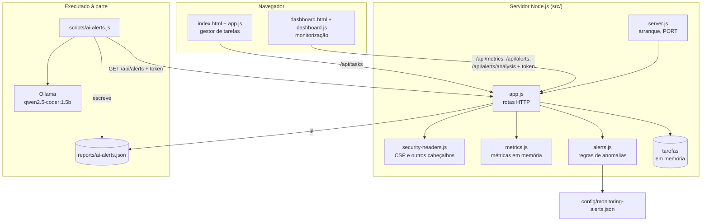
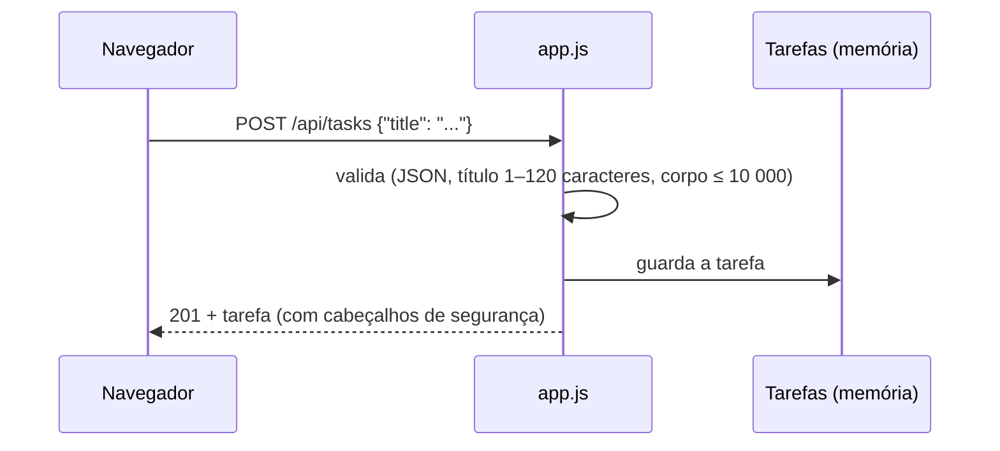
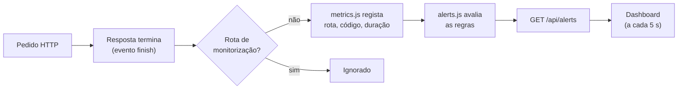
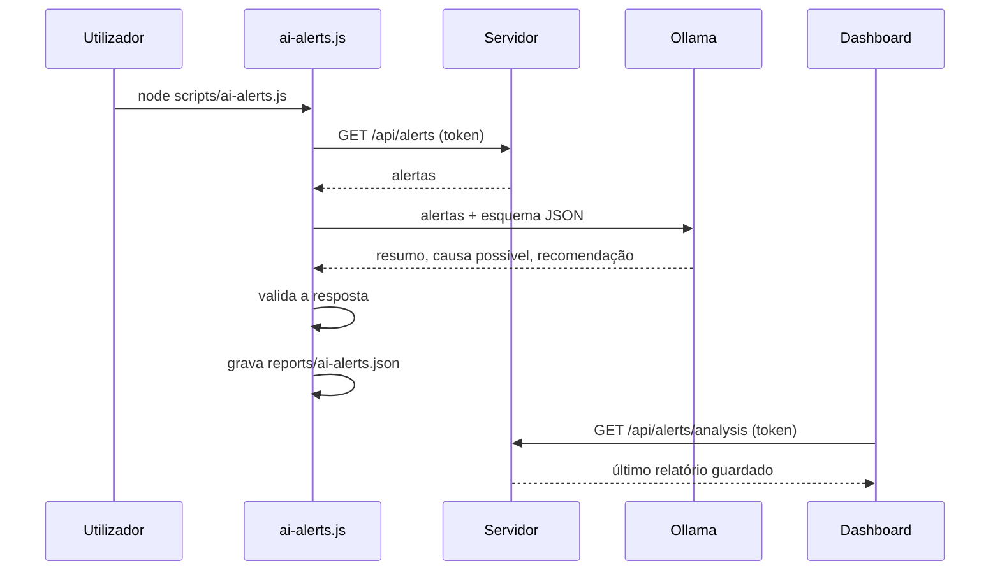
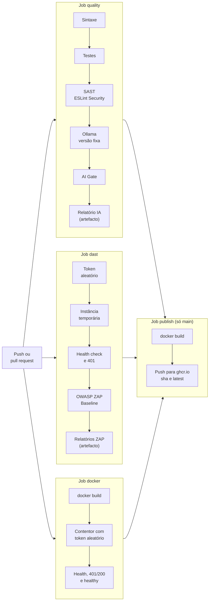

# Arquitetura do TaskFlow-XOps (Sprint 4)

Este documento descreve a arquitetura atual. A arquitetura inicial (Sprints 1
e 2) está em `ArquiteturaTaskflow.pdf` e `Documentaçaoarquitetura.pdf`; as
diferenças estão na secção 7.

## 1. Estilo arquitetural

O TaskFlow mantém o estilo **cliente-servidor em camadas** definido no
Sprint 1 — interface, API HTTP e armazenamento em memória — e acrescenta-lhe
duas camadas transversais:

- **Observabilidade**, dentro do servidor: métricas, alertas e análise com IA.
- **Qualidade e segurança**, fora da aplicação: a pipeline CI/CD com testes,
  SAST, AI Gate e DAST.

O servidor usa apenas o módulo `http` nativo do Node.js (sem Express) e não
tem dependências de execução.

## 2. Componentes

| Componente | Ficheiro | Responsabilidade |
|---|---|---|
| Arranque | `src/server.js` | Lê `PORT` e arranca o servidor |
| Rotas | `src/app.js` | API de tarefas, ficheiros públicos (lista fixa), endpoints de monitorização, registo de métricas |
| Cabeçalhos | `src/security-headers.js` | Cabeçalhos de segurança de todas as respostas; `Cache-Control: no-store` na API |
| Métricas | `src/metrics.js` | Contadores de pedidos, erros e tempos, global e por rota |
| Alertas | `src/alerts.js` | Aplica as regras de `config/monitoring-alerts.json` às métricas |
| Interface | `public/` | HTML, CSS e JavaScript, sem código inline |
| Análise de alertas | `scripts/ai-alerts.js` | Pede ao Ollama resumo, causa possível e recomendação; valida e guarda o relatório |
| AI Gate | `scripts/ai-review.js`, `scripts/ai-gate.js` | Análise de código com IA e decisão PASS/FAIL |

## 3. Fluxos

### 3.1 Gestão de tarefas

### 3.2 Observabilidade

As consultas a `/api/metrics`, `/api/alerts` e `/api/alerts/analysis` **não são
contadas**, para o próprio dashboard não alterar os indicadores que mostra.

| Regra | Condição (por rota, com ≥ 5 pedidos) | Gravidade |
|---|---|---|
| Erros | taxa de erros > 20% | ALTA |
| Lentidão | tempo médio > 50 ms **e** > 2× a média global | MEDIA |

### 3.3 Análise de alertas com IA

A análise **não corre automaticamente**: o dashboard mostra o último relatório
gerado. A "causa possível" é uma hipótese do modelo, não um diagnóstico
confirmado.

### 3.4 Integração contínua

Os jobs `quality`, `dast` e `docker` correm em paralelo: um FAIL do AI Gate
não esconde os resultados do DAST, e o DAST não espera pelos minutos do
Ollama. O job `publish` só corre em *push* para a `main` e só depois de os três
passarem: nenhuma imagem é publicada sem passar por todos os gates.

| Verificação | Bloqueia a pipeline quando |
|---|---|
| Sintaxe | Erro de sintaxe |
| Testes | Qualquer teste falha |
| SAST | Qualquer aviso do ESLint (`--max-warnings=0`) |
| AI Gate | Problema pendente de gravidade ≥ ALTA, ou resposta da IA inválida |
| DAST | Aviso ou falha do ZAP não marcado como `IGNORE` em `config/zap-rules.tsv` |
| Docker | A imagem não constrói, o contentor não responde, a autenticação falha ou o HEALTHCHECK não chega a `healthy` |

## 4. Decisões de arquitetura

| Decisão | Motivo | Evidência |
|---|---|---|
| JavaScript e CSS em ficheiros próprios, sem código inline | Permite uma CSP sem `'unsafe-inline'` | AFL-07; teste que falha se voltar a haver código inline |
| Ficheiros públicos servidos a partir de uma lista fixa | O caminho pedido nunca é usado para aceder ao disco | Teste: `/package.json` e `/src/app.js` devolvem 404 |
| Cabeçalhos de segurança num único módulo | Aplicados a todas as respostas, sem repetição | AFL-07 (ZAP: 6 → 2 avisos) |
| Monitorização excluída das métricas | O dashboard não altera os números que mostra | Teste de não interferência |
| Endpoints de monitorização com token por variável de ambiente | O token não fica no código; sem token configurado, 503 | Testes 401/503, incluindo `Bearer undefined` |
| Análise de alertas com IA fora do ciclo de pedidos | Chamadas ao modelo são lentas e não determinísticas | §3.3 |
| `createServer({ relatorioAlertasPath })` | Testes sem tocar no relatório real | `docs/testes-monitorizacao.md` |
| AI Gate com esquema JSON limitado (`maxLength`) e aprovações por SHA256 | Conter o comportamento não determinístico do modelo | AFL-03 a AFL-06 |
| DAST num job separado, contra instância temporária | Isolamento e paralelismo | `docs/dast-zap.md` |
| Imagem Docker com versão fixa do Node, sem root e sem o token | Reprodutibilidade (AFL-06), menor privilégio, segredos fora da imagem | Job `docker`; `Dockerfile` |
| Publicação só depois de todos os gates, com o `GITHUB_TOKEN` | Entrega contínua sem segredos nem contas externas | Job `publish` |

## 5. Configuração

### Variáveis de ambiente

| Variável | Onde | Uso |
|---|---|---|
| `PORT` | servidor | Porta HTTP (por defeito 3000) |
| `METRICS_TOKEN` | servidor e `ai-alerts.js` | Token dos endpoints de monitorização; sem ele respondem 503 |
| `OLLAMA_VERSION` | CI (job `quality`) | Versão fixa do Ollama instalada |
| `DAST_TARGET` | CI (job `dast`) | Endereço da instância temporária |
| `NODE_ENV` | imagem Docker | `production` |

### Ficheiros de configuração versionados

| Ficheiro | Conteúdo |
|---|---|
| `config/ai-gate-config.json` | Modelo, temperatura, seed, `num_predict`, limites de texto, limite de rejeição, timeout |
| `config/ai-gate-prompt.txt` | Instruções do AI Gate |
| `config/ai-gate-approvals.json` | Aprovações manuais de falsos positivos (por SHA256) |
| `config/monitoring-alerts.json` | Limiares e gravidades dos alertas |
| `config/zap-rules.tsv` | Avisos do ZAP revistos e aceites |

## 6. Limitações

- Tarefas e métricas **em memória**: perdem-se ao reiniciar; uma única
  instância do servidor.
- Sem autenticação de utilizadores; só a monitorização tem token, e é um token
  partilhado.
- `scripts/ai-alerts.js` usa sempre `http://127.0.0.1:3000`: com outro `PORT`,
  a análise de alertas não encontra o servidor.
- Limiares dos alertas fixos e de demonstração.
- O ZAP não analisa o dashboard nem a API (AFL-08).
- A entrega contínua termina na publicação da imagem no `ghcr.io`: não há um
  servidor público onde a aplicação seja instalada automaticamente.
- O DAST analisa o processo Node.js arrancado no runner, não o contentor
  publicado.

## 7. Evolução desde os Sprints 1 e 2

| Aspeto | Sprints 1–2 | Sprint 4 |
|---|---|---|
| Frontend | `index.html` com JavaScript inline | HTML sem código inline + dashboard |
| Backend | Rotas de tarefas | + métricas, alertas, endpoints protegidos, cabeçalhos de segurança, lista fixa de ficheiros |
| IA | Apenas no desenvolvimento (ChatGPT) | AI Gate na pipeline e análise de alertas |
| Pipeline | Sintaxe e testes | + SAST, AI Gate, DAST e imagem Docker, com publicação no `ghcr.io` |
| Testes | 9 (fim do Sprint 2) | 87 |
| Documentação de decisões | Justificação da arquitetura | + Architectural Feedback Log com evidência de runs |
