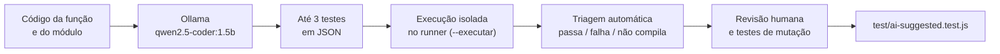

# Testes assistidos por IA (S5-4 · SCRUM-43)

## 1. Objetivo

Avaliar o uso de IA para apoiar a criação de testes automáticos (objetivo 4
do enunciado) e refletir criticamente sobre os resultados (objetivo 7).

**Alvo:** `separarProblemas` em `scripts/ai-gate.js` — a função que decide se
um aviso da IA fica "aprovado" e deixa de bloquear a pipeline. Era a parte mais
sensível do AI Gate e **não tinha nenhum teste**: um erro nela poderia deixar
passar uma vulnerabilidade real como falso positivo aprovado.

## 2. Processo



| Componente | Ficheiro |
|---|---|
| Script | `scripts/ai-test-suggest.js` |
| Instruções versionadas (P2) | `config/ai-test-prompt.txt` |
| Limites da resposta | `config/ai-gate-config.json` (`sugestoesTestes`) |
| Workflow informativo | `.github/workflows/ai-test-suggestions.yml` |
| Testes do script | `test/ai-test-suggest.test.js` |
| Contrato do orçamento de tokens | `test/ai-limites.test.js` |

**Decisões:**

- **Workflow separado e informativo.** Nunca bloqueia a pipeline principal nem
  altera o repositório — conclusão do Architectural Feedback Log: um
  componente não determinístico não deve ser um gate bloqueante sem limites.
- **O código gerado só é executado com `--executar`**, e apenas no runner
  descartável do GitHub Actions. Sem a opção, o script só mostra as sugestões.
- **Nenhuma sugestão entra no projeto sem revisão humana.**

## 3. Resultados

### Execução falhada (run #1) — AFL-10

A primeira execução terminou com `length`: o esquema permitia
5 × (120 + 300 + 1500) = 9600 caracteres, muito acima do `num_predict` (2400).
Os limites passaram para a configuração (3 × 80/160/400) e foi criado um
**teste de contrato** que falha se a resposta máxima de qualquer esquema de IA
puder exceder o `num_predict`. O próprio teste detetou que um primeiro ajuste
(código com 500 caracteres) ainda excedia o limite.

### Iteração 1 — instruções v1 (run #2)

| # | Função testada | Problema | Decisão |
|---|---|---|---|
| 1 | `validarProblemas` | Não é a função pedida (nem é exportada); assume um valor de retorno que não existe | Rejeitada |
| 2 | `validarAnalise` | Não é a função pedida; espera um retorno onde a função lança erro | Rejeitada |
| 3 | `decidirResultado` | Não é a função pedida; dezenas de asserções num teste | Rejeitada |

As três foram **cortadas aos 400 caracteres** e não compilavam. Isto confirmou
que o Ollama aplica o `maxLength` do esquema — questão que estava em aberto no
AFL-06.

### Iteração 2 — instruções v2 (run #3)

Alterações: código da função alvo enviado em destaque, máximo de 3 asserções e
300 caracteres por teste, regra de usar `assert.throws` quando a função lança
erro e exemplo de formato com outra função.

| # | Sugestão | Automático | Revisão | Decisão |
|---|---|---|---|---|
| 1 | `separarProblemas([], {})` devolve listas vazias | falha | Comportamento errado: `{}` sem lista lança erro; a ideia é válida com `undefined` | Corrigida |
| 2 | Gravidade inválida lança erro | passa | **Passa pela razão errada**: `{}` já lança erro sozinho e o teste não verifica a mensagem | Corrigida |
| 3 | Descrição vazia lança erro | passa | Mesmo problema da sugestão 2 | Corrigida |

**Teste de mutação da sugestão 2:** com a validação da gravidade retirada do
código, a versão da IA **continuou a passar**; a versão corrigida falhou, como
deve.

### Resumo

| | v1 | v2 |
|---|---|---|
| Testam a função pedida | 0/3 | 3/3 |
| Compilam | 0/3 | 3/3 |
| Passam automaticamente | 0/3 | 2/3 |
| Aceites sem alterações | 0/3 | 0/3 |
| Aceites com correção | 0/3 | 3/3 |
| Rejeitadas | 3/3 | 0/3 |

**Taxa de aproveitamento global:** 0 de 6 sugestões aceites sem alterações;
3 de 6 aproveitadas depois de corrigidas.

### Cobertura da lógica de aprovação (testes de mutação)

A IA só sugeriu testes de **validação de entradas**. Nenhuma sugestão cobriu a
lógica de aprovação. A equipa escreveu 11 testes para essa lógica e aplicou 7
mutações em `separarProblemas`:

| Mutação | Testes novos | 3 testes da IA (corrigidos) | 14 testes antigos do AI Gate |
|---|---|---|---|
| Assinatura com ≥ 59 em vez de ≥ 60 caracteres | deteta | não | não |
| Ignorar a gravidade | deteta | não | não |
| Ignorar a linha na correspondência exata | deteta | não | não |
| Ignorar a sugestão na correspondência exata | deteta | não | não |
| Ignorar as linhas permitidas | deteta | não | não |
| Ignorar o início da descrição | deteta | não | não |
| Exigir exata **e** assinatura (`||` → `&&`) | deteta | não | não |
| **Total** | **7/7** | **0/7** | **0/7** |

## 4. Reflexão crítica

1. **Um teste que "passa" não é um teste útil.** A triagem automática
   classificou como "passa" duas sugestões que não detetavam nada. Sem revisão
   humana e sem testes de mutação, teriam entrado no projeto e dado uma falsa
   sensação de segurança — o risco mais sério encontrado.
2. **A IA testou o fácil e ignorou o importante.** Validação de entradas é o
   que aparece em qualquer exemplo de testes; a lógica de negócio específica
   (as regras de aprovação) ficou por cobrir. A lacuna mais perigosa foi
   fechada por testes escritos pela equipa.
3. **As instruções importam, mas têm limite.** A v2 passou de 0/3 a 3/3 testes
   sobre a função certa, mas a qualidade das asserções continuou fraca. Com um
   modelo de 1,5B, a IA serve como ponto de partida para uma pessoa, não como
   gerador autónomo.
4. **Valor indireto real:** o exercício expôs que `separarProblemas` não tinha
   testes, revelou o erro de dimensionamento (AFL-10) e confirmou que o
   `maxLength` é aplicado pelo Ollama.
5. **Responsabilidade e ética.** Testes gerados por IA não transferem a
   responsabilidade: quem aceita o teste responde por ele. Executar código
   gerado é um risco de segurança — por isso só corre num ambiente descartável.
   Os testes aceites estão identificados como `[IA, corrigido]`, para ser claro
   o que veio da ferramenta.

## 5. Executar

Sem Ollama no computador, as sugestões podem ser geradas no GitHub Actions:
**Actions → Sugestões de testes com IA → Run workflow** (ficheiro e função).

Localmente, com Ollama (só mostra as sugestões, não executa código gerado):

```powershell
node scripts/ai-test-suggest.js scripts/ai-gate.js separarProblemas
```
